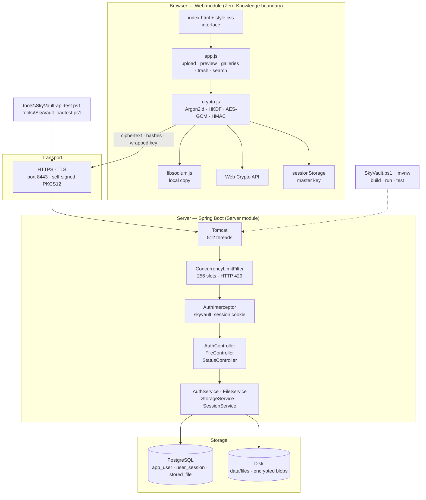
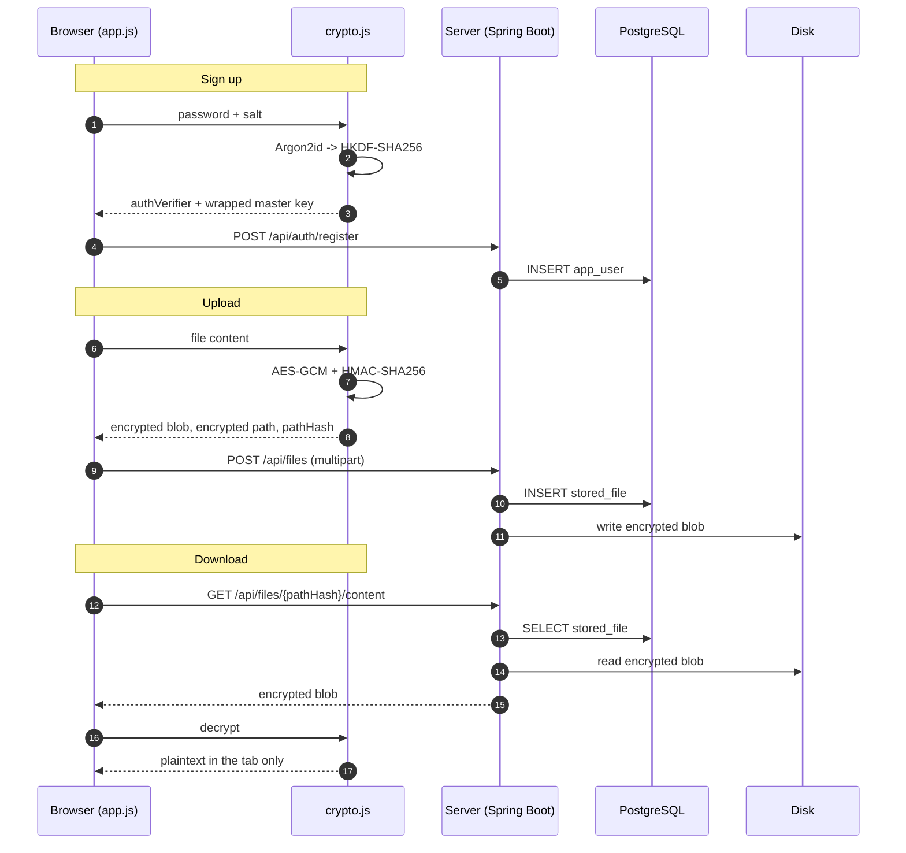

# SkyVault

Engineering thesis project.

**Topic:** Implementation of the Zero-Knowledge architecture in an application that allows storing encrypted data in a computing cloud.

Author: Patryk Rysiński · Kielce University of Technology · Teleinformatics

## Project status

Completed: the **technology skeleton**, the **Zero-Knowledge API** (registration, login,
sessions, operations on encrypted files), the **drive browsing interface with media
galleries** (browser-generated thumbnails, no ffmpeg) and a **settings page with three
30-day storage plans** — with Mono as the default palette and three optional color
themes, encrypting all data in the browser. Plan dates are kept by the server and
mirrored to a plain-text file; an expired plan disables the account until it is renewed.
Server startup is driven by `skyvault.config.json` (JVM heap and processors, Tomcat
threads and connections, API limits, data paths, database pool, sessions, logging and
server-side backups).

## Structure

```
SkyVault\
|-- SkyVault.ps1      <- LAUNCHER. Reads the config and starts the modules.
|-- SkyVault.cmd      <- same as above, for double-click launch
|-- pom.xml           <- project root (aggregates the modules)
|-- skyvault.config.json        <- server configuration (JVM, HTTP, data, DB)
|-- skyvault.config.schema.json <- JSON Schema for editors
|-- skyvault.config.local.json  <- optional machine-local overrides (gitignored)
|
|-- Web\              <- WEB MODULE
|   `-- src\main\resources\META-INF\resources\
|       |-- index.html          <- GUI skeleton (custom SVG icon sprite)
|       |-- style.css           <- four color themes via CSS variables
|       |-- palettes.html       <- visual preview of all four palettes
|       |-- crypto.js           <- Argon2id, HKDF, AES-GCM (WebCrypto + libsodium)
|       |-- app.js              <- SPA logic: drive, libraries, trash, upload
|       `-- vendor\             <- libsodium (local copy, no CDN)
|
`-- Server\           <- SERVER MODULE
    `-- src\main\
        |-- java\com\skyvault\
        |   |-- ServerApplication.java
        |   |-- api\          <- /api/status, /api/ping
        |   |-- auth\         <- registration, login, crypto bundle
        |   |-- file\         <- file metadata, blobs, trash
        |   |-- backup\       <- server-side LZMA2 backups
        |   |-- session\      <- sessions and endpoint protection
        |   |-- user\         <- user account
        |   |-- concurrency\  <- limit of 256 concurrent requests
        |   |-- config\       <- Spring configuration
        |   `-- error\        <- API error handling
        `-- resources\
            |-- application.properties
            `-- db\migration\        <- Flyway migrations
```

**Why modules instead of a single project?** Web is a separate artifact (a JAR with the site
files). Server depends on Web, so the site is served automatically — without copying files
and without a separate HTTP server. As a bonus, a change in the site's look does not require
rebuilding the server code.

## Architecture

Component view of the running system:



Runtime view — what happens during registration, upload and download:



The Server block never receives the password, the master key, plaintext file names or
plaintext content. That is the Zero-Knowledge boundary; the sections below describe each part.

## What each folder does

| Folder / file | Responsibility |
|---|---|
| `SkyVault/` | repository root: launcher, aggregate `pom.xml`, documentation |
| `SkyVault.ps1`, `SkyVault.cmd` | launcher: validates the config, applies JVM flags and starts the modules |
| `skyvault.config.json` | base server config: heap, processors, Tomcat, limits, data paths, DB, sessions, logs |
| `skyvault.config.local.json` | optional machine-local overlay, gitignored; good place for real passwords |
| `skyvault.config.schema.json` | JSON Schema used by editors for validation and completion |
| `tools/` | helper scripts; nothing here is needed to build or run the server |
| `tools/SkyVault-api-test.ps1` | end-to-end API test against a running server |
| `tools/SkyVault-loadtest.ps1` | parallel load test that verifies the 256 limit and HTTP 429 |
| `Web/` | web module: the static interface, packaged as a JAR |
| `Web/.../META-INF/resources/` | `index.html`, `style.css`, `app.js`, `crypto.js`, `vendor/` (libsodium) |
| `Server/` | server module: Spring Boot application; depends on Web |
| `Server/.../com/skyvault/` | backend packages: `api`, `auth`, `file`, `backup`, `plan`, `session`, `user`, `concurrency`, `config`, `error` |
| `Server/.../resources/` | `application.properties` fallbacks and Flyway migrations (`db/migration`) |
| `data/` | runtime directory, gitignored: encrypted blobs in `data/files/u{id}/`, `data/plans.json` and `data/tmp/` |
| `backups/` | runtime directory, gitignored: LZMA2 `.7z` archives and their `.json` metadata |
| `logs/` | runtime log directory, gitignored; rolling `skyvault.log` |

## Technology stack

| Layer | Technology |
|---|---|
| Language | Java 25 (LTS) |
| Backend | Spring Boot 4.1.1 (Spring Web MVC, Spring Data JPA, Actuator) |
| Persistence | Hibernate ORM 7.4.5, `ddl-auto=validate` |
| Database | PostgreSQL 18.6 |
| Migrations | Flyway (`db/migration`) |
| Web container | Apache Tomcat 11.0.24 (embedded) |
| Build | Maven with the `mvnw` wrapper |
| Frontend | plain HTML, CSS and JavaScript; no framework, no build step |
| Browser crypto | Web Crypto API (HKDF-SHA256, AES-GCM) + libsodium.js (Argon2id, local copy) |
| Transport | JSON over HTTPS (TLS); multipart for encrypted uploads |
| Backup compression | Apache Commons Compress + XZ (7z / LZMA2, pure Java) |
| Tests | JUnit 5 / Spring Boot Test, plus PowerShell API and load scripts |

## Running

```powershell
cd C:\Users\PKR\Desktop\KOD\SkyVault
.\SkyVault.ps1
```

The launcher supports these modes:

| Mode | Action |
|---|---|
| `run` | build and run the server *(default)* |
| `build` | build all modules (`-SkipTests` skips tests) |
| `test` | run tests |
| `clean` | clean the `target` directories |
| `modules` | show the module list |
| `config` | validate the config and print the effective values and Java command |
| `help` | help |

Useful switches:

| Switch | Meaning |
|---|---|
| `-SkipTests` | build without running tests |
| `-SkipBuild` | with `run`: start the existing JAR without rebuilding |
| `-ConfigFile <path>` | use a different JSON config file |
| `-NoLocalConfig` | ignore `skyvault.config.local.json` |

If PowerShell blocks scripts:

```powershell
powershell -ExecutionPolicy Bypass -File .\SkyVault.ps1 build
```

Maven **is not** required — the project uses the `mvnw.cmd` wrapper, which downloads the right
version by itself. Required: **JDK 25**, **PostgreSQL 18** and a set `JAVA_HOME`.

## Server configuration

Server startup is controlled by `skyvault.config.json` in the project root. The launcher
validates the file, translates the JVM section into real Java flags, resolves relative paths
against the config directory and exports the rest as Spring Boot properties before the JAR
starts.

```
skyvault.config.json         base configuration, committed to the repository
skyvault.config.local.json   optional local overlay, gitignored
skyvault.config.schema.json  JSON Schema for editor validation/completion
```

Precedence, strongest first:

1. environment variables (`SERVER_PORT`, `DB_PASSWORD`, `MAX_CONCURRENT_USERS`, ...),
2. `skyvault.config.local.json`,
3. `skyvault.config.json`,
4. defaults in `Server/src/main/resources/application.properties` (only relevant when the JAR
   is started directly without the launcher).

Show the effective result without starting the server:

```powershell
.\SkyVault.ps1 config
.\SkyVault.ps1 config -ConfigFile .\my-server.json
```

> **RAM and cores are JVM-level settings.** The application cannot change them at runtime.
> `jvm.heapMinMb`, `jvm.heapMaxMb`, `jvm.activeProcessors` and `jvm.garbageCollector` become
> `-Xms`, `-Xmx`, `-XX:ActiveProcessorCount` and the selected GC flag. Changing them always
> requires a restart. Starting the JAR directly with `java -jar` skips these flags; use the
> launcher or pass them manually.

### Listener, threads and connections

| Key | Default | Meaning |
|---|---|---|
| `server.host` | `0.0.0.0` | bind address; `0.0.0.0` means all interfaces |
| `server.port` | `8443` | HTTPS port |
| `server.https` | `true` | TLS on/off (HTTP is only for development or a trusted proxy) |
| `server.threads.max` | `512` | maximum Tomcat request threads |
| `server.threads.minSpare` | `16` | minimum idle Tomcat threads |
| `server.maxConnections` | `8192` | maximum simultaneous TCP connections |
| `server.acceptCount` | `512` | OS accept queue when all threads are busy |
| `server.connectionTimeoutMs` | `20000` | time to wait for the request line/headers |
| `server.keepAliveTimeoutMs` | `20000` | keep-alive idle time |
| `server.maxConcurrentUsers` | `256` | application semaphore for `/api/**` |
| `server.acquireTimeoutMs` | `2000` | wait for a free API slot before HTTP 429 |
| `server.maxHttpRequestHeaderSize` | `16KB` | maximum request header size |
| `server.maxHttpFormPostSize` | `2MB` | maximum classic form body |

### JVM, data and database

| Key | Default | Meaning |
|---|---|---|
| `jvm.heapMinMb` / `jvm.heapMaxMb` | `512` / `2048` | initial and maximum Java heap |
| `jvm.activeProcessors` | `null` | processor count seen by the JVM; `null` = all logical CPUs |
| `jvm.garbageCollector` | `g1` | `g1`, `zgc`, `parallel`, `serial` or `default` |
| `jvm.directMemoryMb` | `null` | optional direct-memory cap |
| `jvm.tempDirectory` | `data/tmp` | `java.io.tmpdir`, also used by multipart uploads |
| `storage.dataDirectory` | `data/files` | encrypted blobs, one `u{id}` directory per user |
| `storage.planStateFile` | `data/plans.json` | plain-text plan mirror |
| `storage.defaultQuotaGb` | `5` | initial quota for a new account |
| `storage.maxUploadMb` / `storage.maxRequestMb` | `100` / `110` | multipart limits |
| `database.host` / `port` / `name` | `127.0.0.1` / `5432` / `skyvault` | PostgreSQL target |
| `database.user` / `password` | `skyvault` / `skyvault` | development credentials |
| `database.poolSize` / `poolMinIdle` | `10` / `2` | HikariCP pool |
| `session.lifetimeDays` | `7` | browser session and cookie lifetime |
| `session.cookieName` | `skyvault_session` | session cookie name |
| `logging.level` / `logging.file` | `INFO` / `logs/skyvault.log` | root log level and rolling file |

The launcher honours the documented short names (`PORT`, `DB_*`, `MAX_CONCURRENT_USERS`,
`SKYVAULT_DATA_DIR`, ...) and the full Spring form for the remaining properties: uppercase the
property name and replace dots with underscores, for example `server.maxConnections` →
`SERVER_TOMCAT_MAX_CONNECTIONS`. `jvm.extraArgs` is JSON-only.

Put real passwords in `skyvault.config.local.json` or the environment, not in the committed
base file. The local overlay is ignored by Git.

### Live view

`GET /api/system` returns a read-only snapshot of the effective configuration and runtime:
JVM flags, heap usage, CPU load, thread counts, disk space, Tomcat limits, Hikari pool,
session settings and the sanitized database URL. Passwords and session tokens are never
returned. `GET /api/status` stays the small concurrency-status endpoint used by the load test.

## Addresses

| Address | Description |
|---|---|
| `https://localhost:8443/` | SkyVault interface |
| `https://localhost:8443/api/status` | server status and concurrency counter |
| `https://localhost:8443/api/system` | effective config, JVM, CPU, memory, disk and pool snapshot |
| `https://localhost:8443/api/backup` | backup policy and the archives on disk |
| `https://localhost:8443/api/ping?delayMs=500` | request with a simulated delay |
| `https://localhost:8443/actuator/health` | application and database health |
| `https://<server-ip>:8443/` | the same interface from another computer in the LAN |

The host, port and TLS switch come from `server.host`, `server.port` and `server.https` in
`skyvault.config.json`. The server serves **only HTTPS** by default (there is no HTTP connector).
The development certificate is a self-signed PKCS12 file:
`Server/src/main/resources/skyvault-dev.p12`, alias `skyvault`, password `skyvault`, valid for
10 years. The SAN list contains `localhost`, `127.0.0.1`, `::1`, the computer name and the LAN
address. The browser shows a certificate warning once — choose **Advanced → Proceed**. The page
is then a secure context and Web Crypto works, also from another computer.

> The certificate is for development only. To use the project outside the LAN, replace it with
> a certificate from a trusted CA. Configure it through `tls.keystore` and `tls.keystorePassword`
> in `skyvault.config.json`; `SSL_KEYSTORE_PASSWORD` and `PORT` still work as environment
> overrides.

If another computer cannot connect, allow the port in Windows Firewall (administrator shell).
The rule must match the network profile — `Private` for a home or laboratory network:

```powershell
New-NetFirewallRule -DisplayName "SkyVault HTTPS 8443" -Direction Inbound `
    -Protocol TCP -LocalPort 8443 -Action Allow -Profile Private
```

## Zero-Knowledge API

The server **does not know the password, the master key or the file names**. All cryptography
happens in the browser:

```
password
  -> Argon2id(salt 16 B, 256 MB)        = seed 32 B
  -> HKDF-SHA256("AuthVerifier")        = authVerifier 32 B   -> the server receives SHA-256
  -> HKDF-SHA256("MasterKey KEK")       = KEK 32 B
masterKey 32 B (random)
  -> AES-GCM(KEK, iv 12 B)              = wrappedMasterKey 48 B -> the server stores it unchanged
```

The server stores only: the verifier hash, the salt, the wrapped master key and
encrypted paths. There is **no** column with a plaintext file name.

### Blob format

The client sends the encrypted content as a single chunk:

```
blob = "SKYVAULT-AESGCM-v1\n" (19 B) || IV (12 B) || AES-GCM(master key, content)
```

The header uniquely identifies the format and version, so the IV is part of the blob
and the server does not have to store it anywhere. Version detection is not based on the
file length or on heuristics: decryption reads the magic header, and when it is missing,
it falls back to the old `IV || ciphertext` layout (backward compatibility).

`sizeBytes` is the plaintext size (before encryption), and `storedSizeBytes` — the size of
what actually reached the server (with this convention: `sizeBytes + 47`:
19 B of header + 12 B of IV + 16 B of AES-GCM tag).

The path has a separate `virtualPathIv` field, because its ciphertext and IV are returned
to the client together with the metadata.

### Authentication

| Method | Endpoint | Description |
|---|---|---|
| `POST` | `/api/auth/register` | crypto bundle -> account and session creation |
| `POST` | `/api/auth/login` | verifier -> session |
| `POST` | `/api/auth/password` | re-wrap the master key with a new password (session required) |
| `POST` | `/api/auth/settings` | save the encrypted account settings, e.g. the color theme (session required) |
| `POST` | `/api/auth/plan` | renew or switch the storage plan for 30 days: `free` 5 GB, `plus` 200 GB, `pro` 1 TB (session required) |
| `POST` | `/api/auth/logout` | end of session |
| `GET` | `/api/auth/crypto?email=` | salt and wrapped master key |
| `GET` | `/api/auth/me` | profile of the logged-in user |

`/api/auth/crypto` returns material with the correct shape even for a nonexistent address,
so it cannot be used to check which accounts exist.

### Changing the master password

`POST /api/auth/password` changes only the wrapper around the master key. The client proves
the current password with its verifier, unwraps the master key with the old KEK and wraps
the same key with a KEK derived from the new password:

```
current password -> Argon2id + HKDF -> KEK_old -> unwrap master key
new password     -> Argon2id + HKDF -> KEK_new -> AES-GCM(KEK_new, master key)
```

The server verifies `currentAuthVerifier`, stores the new salt and wrapped key, and revokes
all sessions of the account; the browser that made the change receives a fresh cookie.
The master key itself never changes, so `pathHash` values, encrypted paths and every file
blob remain valid — nothing is re-encrypted.

### Files (require a session)

| Method | Endpoint | Description |
|---|---|---|
| `GET` | `/api/files` | list of active files and folders |
| `GET` | `/api/files/trash` | trash contents |
| `POST` | `/api/files` | file registration (multipart: metadata + encrypted blob) |
| `POST` | `/api/folders` | create a folder |
| `GET` | `/api/files/{pathHash}/content` | download the encrypted blob |
| `POST` | `/api/files/{pathHash}/move` | rename or move |
| `POST` | `/api/files/{pathHash}/trash` | move to trash |
| `POST` | `/api/files/{pathHash}/restore` | restore from trash |
| `POST` | `/api/files/{pathHash}/star` | mark with a star |
| `DELETE` | `/api/files/{pathHash}` | permanent delete (trash only) |

`pathHash` is `HMAC-SHA256(masterKey, "SkyVault path v1:" + path)` in hex form.
It is deterministic, so the server can search and detect conflicts without knowing the path.
The HMAC key is different for every user, so the same names cannot be correlated
across accounts.

Full flow test: `.\tools\SkyVault-api-test.ps1` (the server must be running). The script accepts the
development certificate automatically.

## Interface (GUI)

The site is plain HTML/CSS/JS served from the `Web` module — no framework and no
frontend build process. The layout and mechanics were carried over from the old project
(C#/Angular), but the code and the look are new. The default palette, **Mono**, is a
grayscale scale from `#0a0a0a` to `#ffffff`; the sun icon in the top bar switches between
four palettes (Mono, Nord, Forest, Amber), and the choice is encrypted in the browser
with a key derived from the master key, then stored in the account
(`app_user.encrypted_settings`) with a `localStorage` cache for instant loading.
`palettes.html` shows all four side by side. The icons are a custom SVG sprite
(`currentColor`), with no external sets.

Views:

| View | Contents |
|---|---|
| Home / My Drive | folders and files of the selected level, breadcrumbs |
| Computers | information about the current session and the rule for unlocking on the device |
| Documents, Images, Videos, Music | libraries filtered by extension; Images, Videos and Music open as a media gallery |
| Recent | the 60 newest files from the whole drive |
| Starred | files and folders with a star |
| Trash | restore and permanent delete |
| Storage | quota usage, largest files, encryption overhead |
| Settings / Plans | three storage plans (Free 5 GB, Plus 200 GB, Pro 1 TB), 30-day access, current usage and one-click renewal |

Mechanics:

- **Upload** — with a button, by dragging files or a whole folder onto the workspace,
  or as a whole directory (`Upload folder` in the right-click menu). A dropped folder
  keeps its internal structure, including subfolders. A file is encrypted in the tab
  and only then sent; a name conflict is resolved automatically (`note (1).txt`).
- **Download and preview** — a download decrypts the blob in the browser. Preview supports
  images, videos, audio, PDF and text (`text/plain` and common code extensions).
- **Media galleries** — Images, Videos and Music open in a gallery grid by default.
  Photos are rasterized to WebP thumbnails with Canvas, videos show a poster frame from
  the first seconds together with their duration, and audio uses embedded cover art
  (ID3/FLAC/MP4) or a generated waveform. Decryption and rendering happen only in the
  tab: there is no ffmpeg or server-side media processing. Thumbnails load lazily (two
  jobs at a time) and stay in an in-memory cache of 80 items; files larger than 48 MB
  (images), 96 MB (videos) or 32 MB (audio) keep a styled placeholder. The grid/list
  choice is remembered separately for each library (`skyvaultViewMode:images`, etc.).
- **Names and folders** — rename, move (also by dragging onto a folder),
  folder creation. A folder is moved together with its entire contents.
- **Account** — the account menu downloads the recovery card and changes the master
  password. Changing it re-wraps the master key only; files are not re-encrypted.
- **Trash** — move, restore and permanent delete; empty everything.
- **Context menu** (right mouse button) — open/preview, download, star, rename,
  move, details, trash; on an empty area — new folder, upload files and a directory, refresh.
- **Color themes** — the sun icon opens a picker: Mono (default), Nord, Forest and Amber.
  The selection applies instantly, is cached in `localStorage`, and is saved to the account
  as an encrypted blob (`POST /api/auth/settings`), so the server never learns the chosen
  theme, and the same user sees it on every device after signing in.
- **Plans and expiry** — every plan is free and lasts **30 days** from the moment it is chosen.
  The server owns the plan: it keeps `plan_started_at` / `plan_expires_at` in PostgreSQL and
  writes a plain-text mirror with the plan, both dates and the active flag to
  `data/plans.json` (no passwords, verifier hashes or keys). When the date passes, the server
  marks the account inactive: `/api/auth/me` reports `planActive: false`, file and folder
  endpoints return HTTP 403 with `PLAN_EXPIRED`, and the interface switches to the plans
  screen with an **Account disabled** banner. Choosing any plan (including the current one)
  starts a new 30-day period and unlocks the drive.
- **Shortcuts** — `Ctrl+F` search, `F2` rename, `Delete` to trash, `Enter` open.

The master key lives only in the tab's `sessionStorage`: closing the tab forgets the key,
and opening SkyVault in a new tab asks for the password ("unlock the drive") — the server
session is still valid, but no one can recreate the key without the password. After registration
the client downloads a **recovery card** with the master key; without it, losing the password
means losing the data.

Web Crypto requires a secure context. SkyVault always runs over HTTPS — also on `localhost` —
so Argon2id, HKDF and AES-GCM work both on the server machine and on another computer in the
LAN. Plain HTTP is not served at all.

Static resources are served with `Cache-Control: no-store`. Reason: Spring Boot packs
JAR entries with the date 1980-02-01 (reproducible builds), so the browser would get `304`
and keep the old interface after an update.

## Concurrency limit

The server handles **at most 256 users** at the same time.

The mechanism has two layers:

1. **Tomcat thread pool** — `server.threads.max` (512 by default). Deliberately more than 256:
   the surplus traffic reaches the application semaphore and is rejected quickly, instead of
   waiting silently in the connector queue.
2. **Application semaphore** — `ConcurrencyLimiter` with `server.maxConcurrentUsers` slots
   (256 by default). Requests to `/api/**` take a slot for the duration of handling. When all
   256 are taken, a request waits `server.acquireTimeoutMs` (2000 ms by default) and then gets
   **HTTP 429 Too Many Requests**.

Requests for static files and `/actuator/**` are **not** counted — thanks to that the site
always loads, and monitoring works even under full load.

Measured with `.\tools\SkyVault-loadtest.ps1 -Requests 640 -DelayMs 3000`: 427 x `200`, 213 x `429`,
peak load 256.

Relevant keys in `skyvault.config.json`:

```json
{
  "server": {
    "threads": { "max": 512, "minSpare": 16 },
    "maxConnections": 8192,
    "acceptCount": 512,
    "maxConcurrentUsers": 256,
    "acquireTimeoutMs": 2000
  }
}
```

They can be overridden without editing the file:

```powershell
$env:MAX_CONCURRENT_USERS = 32
.\SkyVault.ps1
```

`.\SkyVault.ps1 config` prints the effective values before launch.

## Database

The `skyvault` database and the `skyvault` role must exist:

```sql
CREATE ROLE skyvault LOGIN PASSWORD 'skyvault';
CREATE DATABASE skyvault OWNER skyvault;
```

Default connection: `127.0.0.1:5432 / skyvault`, user `skyvault`, password `skyvault`.
Configure it through `database.host`, `database.port`, `database.name`, `database.user`,
`database.password`, `database.poolSize` and the timeout keys in `skyvault.config.json`.
Environment variables still win: `DB_HOST`, `DB_PORT`, `DB_NAME`, `DB_USER`, `DB_PASSWORD`,
`DB_POOL_SIZE`, `DB_POOL_MIN_IDLE`, `DB_CONNECTION_TIMEOUT_MS`, `DB_IDLE_TIMEOUT_MS`,
`DB_MAX_LIFETIME_MS`.

> The `skyvault` password is a **development-only** value. Before deployment, put the real one
> in `skyvault.config.local.json` (gitignored) or `DB_PASSWORD` from outside the repository.

Flyway migrations live in `Server/src/main/resources/db/migration`. The schema is described by
`V1__init_schema.sql` (tables `app_user`, `user_session`, `stored_file`),
`V2__add_user_theme.sql` (the initial plaintext theme preference),
`V3__encrypt_user_settings.sql` (encrypted `app_user.encrypted_settings` / `settings_iv`;
the plaintext `theme` column is removed), `V4__add_user_plan.sql`
(the `app_user.plan` field with the `free` / `plus` / `pro` values) and
`V5__add_plan_expiry.sql` (`plan_started_at` / `plan_expires_at`; existing accounts get
30 days from the migration).

Flyway **is needed**: `spring.jpa.hibernate.ddl-auto=validate` checks at startup
whether the entities match the schema. Without migrations, adding a new entity would make it
impossible to start the application.

Rule: `V1__...` files are not edited after being executed on the database — every change is a new file
with the next number.

### File storage

Encrypted blobs go to `data/files/u{id}/`. The server writes the bytes exactly in the form
in which it received them from the client — it has no key, so it cannot read them.

The server also writes `data/plans.json`, a plain-text snapshot of plan state:
`userId`, `email`, `plan`, `planStartedAt`, `planExpiresAt`, `active` and `secondsLeft`.
It deliberately contains **no** password verifier, wrapped master key or encrypted settings.
The file is refreshed at startup, after every plan change or registration, and every 30 s
when an account expires. PostgreSQL remains the source of truth; the file is the readable,
server-owned plan record and an audit trail.

The `data/` directory is in `.gitignore`.

| Variable | Config key | Default | Meaning |
|---|---|---|---|
| `SKYVAULT_STORAGE_DIRECTORY` (alias `SKYVAULT_DATA_DIR`) | `storage.dataDirectory` | `data/files` | directory for blobs |
| `SKYVAULT_STORAGE_PLAN_STATE_FILE` (alias `SKYVAULT_PLAN_FILE`) | `storage.planStateFile` | `data/plans.json` | plain-text plan state file |
| `SKYVAULT_STORAGE_PLAN_STATE_REFRESH_MS` (alias `PLAN_STATE_REFRESH_MS`) | `storage.planStateRefreshMs` | `30000` | how often the expiry state is checked/written |
| `SKYVAULT_STORAGE_DEFAULT_QUOTA_GB` (alias `DEFAULT_QUOTA_GB`) | `storage.defaultQuotaGb` | `5` | space limit per new account |
| `JAVA_TMP_DIR` | `jvm.tempDirectory` | `data/tmp` | JVM and multipart temporary directory |

The launcher resolves relative paths against the config file's directory and creates the
directories before the JVM starts, so running from another working directory does not move the
data.

### Server-side backups

The server creates the backups itself. Nothing is installed in Windows Task Scheduler and no
external 7-Zip binary is used: `BackupService` writes 7z archives with LZMA2 compression through
Apache Commons Compress and XZ, entirely in Java. The daily run, retention and archive
verification are part of the Spring application, so they work whenever the server is running.

Default policy:

| Key | Default | Meaning |
|---|---|---|
| `backup.enabled` | `true` | enable the automatic backup |
| `backup.schedule.time` | `00:00` | local server time of the daily run |
| `backup.retention.copies` | `2` | number of newest archives kept |
| `backup.compression.level` | `9` | LZMA2 level (0–9; 9 is the strongest) |
| `backup.compression.dictionaryMb` | `64` | LZMA2 dictionary size in MB |
| `backup.directory` | `backups` | archive and metadata directory |
| `backup.includeDatabase` | `true` | `pg_dump` custom-format dump |
| `backup.includeFiles` | `true` | encrypted blobs from `storage.dataDirectory` |
| `backup.includePlanState` | `true` | `storage.planStateFile` |
| `backup.verifyAfterCreate` | `true` | read the archive back and verify CRC checksums |
| `backup.catchUp` | `true` | startup catch-up when the newest archive is older than 24 h |
| `backup.pgDumpPath` | `null` | `pg_dump` path or PostgreSQL `bin` directory; `null` = PATH / Program Files |

The schedule is stored as `HH:mm`; the launcher translates it to the Spring cron expression
`SKYVAULT_BACKUP_CRON` (`0 minute hour * * *`). The environment variables are named
`SKYVAULT_BACKUP_ENABLED`, `SKYVAULT_BACKUP_DIRECTORY`, `SKYVAULT_BACKUP_KEEP_COPIES`,
`SKYVAULT_BACKUP_COMPRESSION_LEVEL`, `SKYVAULT_BACKUP_DICTIONARY_MB`,
`SKYVAULT_BACKUP_INCLUDE_DATABASE`, `SKYVAULT_BACKUP_INCLUDE_FILES`,
`SKYVAULT_BACKUP_INCLUDE_PLAN_STATE`, `SKYVAULT_BACKUP_VERIFY_AFTER_CREATE`,
`SKYVAULT_BACKUP_CATCH_UP` and `SKYVAULT_BACKUP_PG_DUMP_PATH`.

Layout of every archive:

```
<user files — the same relative paths as in data/files>
.skyvault-backup/database.dump
.skyvault-backup/plans.json
.skyvault-backup/manifest.json
.skyvault-backup/RESTORE.txt
```

A `.json` sidecar next to each archive records the SHA-256, size, creation time, kind and
component list. After a successful run the server deletes the oldest archives above the
retention limit. If the database is included and `pg_dump` fails, the whole run fails and no
incomplete archive is left behind. `pg_dump` comes from the PostgreSQL client tools; the
default detection checks `PATH` and `C:\Program Files\PostgreSQL\*\bin`.

`GET /api/backup` returns the effective policy, whether a backup is currently running, and all
archives with their metadata.

Restore (stop the server first):

```powershell
# 1. user files
7z x backups\skyvault-20261025-000000.7z -odata\files -x!.skyvault-backup

# 2. database (password is not stored in the archive)
$env:PGPASSWORD = 'skyvault'
pg_restore --clean --if-exists --no-owner --no-privileges --single-transaction --exit-on-error `
    --host 127.0.0.1 --port 5432 --username skyvault --dbname skyvault `
    .skyvault-backup\database.dump

# 3. plan state
Copy-Item .skyvault-backup\plans.json data\plans.json
```

Use any 7-Zip-compatible extractor; the project no longer ships `7zr.exe`. The manifest and the
sidecar contain the checksums needed to confirm that the restored dump and plan file are intact.

## Tests

```powershell
.\SkyVault.ps1 test
```

- `ServerApplicationTests` — whether the Spring context starts (configuration, database, Flyway).
- `BackupServiceTests` — LZMA2 archive contents, metadata, checksums and the two-copy retention.
- `ConcurrencyLimiterTests` — whether the concurrency limit is actually not exceeded
  with 200 parallel requests.

## Server concurrency test

A separate tool to check the 256 limit on a running server:

```powershell
.\tools\SkyVault-loadtest.ps1                            # 320 requests, default limit 256
.\tools\SkyVault-loadtest.ps1 -Requests 40 -DelayMs 3000 # quick verification of the 429 path
```

The script sends real parallel connections and counts `200` and `429` responses. It accepts the
development certificate automatically. `DelayMs` must be greater than `acquire-timeout-ms`
(2000 ms by default) — otherwise the excess will wait for a free slot and get `200` instead
of `429`.

Why is this not on the site? A browser opens only a few connections at a time to a single
server, so the 256-slot limit cannot be filled from the browser.

## Next steps

1. ~~Database schema design for the Zero-Knowledge architecture~~ — done (`V1__init_schema.sql`).
2. ~~Registration and login~~ — done.
3. ~~Client-side encryption in the browser (AES-GCM, Argon2id, HKDF) and the browsing GUI~~ — done (`Web` module).
4. Functional tests and evaluation of system operation — required in the thesis plan.
