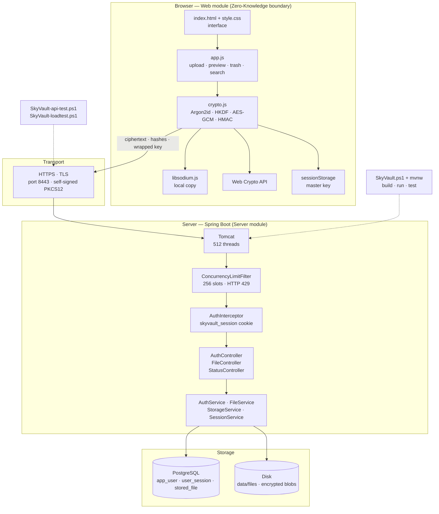
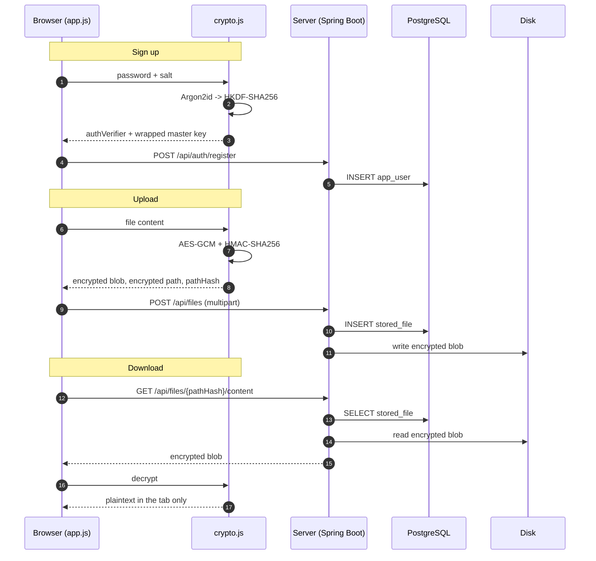

# SkyVault

Engineering thesis project.

**Topic:** Implementation of the Zero-Knowledge architecture in an application that allows storing encrypted data in a computing cloud.

Author: Patryk Rysinski · Kielce University of Technology · Teleinformatics
Supervisor: Mariusz Ginter, PhD

## Project status

Completed: the **technology skeleton**, the **Zero-Knowledge API** (registration, login,
sessions, operations on encrypted files) and the **drive browsing interface** —
entirely in black and white, encrypting all data in the browser.

## Structure

```
SkyVault\
|-- SkyVault.ps1      <- LAUNCHER. Only starts the modules, no application logic.
|-- SkyVault.cmd      <- same as above, for double-click launch
|-- pom.xml           <- project root (aggregates the modules)
|
|-- Web\              <- WEB MODULE
|   `-- src\main\resources\META-INF\resources\
|       |-- index.html          <- GUI skeleton (custom SVG icon sprite)
|       |-- style.css           <- black and white theme, grayscale only
|       |-- crypto.js           <- Argon2id, HKDF, AES-GCM (WebCrypto + libsodium)
|       |-- app.js              <- SPA logic: drive, libraries, trash, upload
|       `-- vendor\             <- libsodium (local copy, no CDN)
|
`-- Server\           <- SERVER MODULE
    `-- src\main\
        |-- java\com\skyvault\
        |   |-- ServerApplication.java
        |   |-- api\          <- /api/status, /api/ping
        |   |-- auth\         <- registration, login, crypto bundle
        |   |-- file\         <- file metadata, blobs, trash
        |   |-- session\      <- sessions and endpoint protection
        |   |-- user\         <- user account
        |   |-- concurrency\  <- limit of 256 concurrent requests
        |   |-- config\       <- Spring configuration
        |   `-- error\        <- API error handling
        `-- resources\
            |-- application.properties
            `-- db\migration\        <- Flyway migrations
```

**Why modules instead of a single project?** Web is a separate artifact (a JAR with the site
files). Server depends on Web, so the site is served automatically — without copying files
and without a separate HTTP server. As a bonus, a change in the site's look does not require
rebuilding the server code.

## Architecture

Component view of the running system:



Runtime view — what happens during registration, upload and download:



The Server block never receives the password, the master key, plaintext file names or
plaintext content. That is the Zero-Knowledge boundary; the sections below describe each part.

## What each folder does

| Folder / file | Responsibility |
|---|---|
| `SkyVault/` | repository root: launcher, aggregate `pom.xml`, documentation |
| `SkyVault.ps1`, `SkyVault.cmd` | launcher only (build / run / test / clean); no application logic |
| `SkyVault-api-test.ps1` | end-to-end API test against a running server |
| `SkyVault-loadtest.ps1` | parallel load test that verifies the 256 limit and HTTP 429 |
| `Web/` | web module: the static interface, packaged as a JAR |
| `Web/.../META-INF/resources/` | `index.html`, `style.css`, `app.js`, `crypto.js`, `vendor/` (libsodium) |
| `Server/` | server module: Spring Boot application; depends on Web |
| `Server/.../com/skyvault/` | backend packages: `api`, `auth`, `file`, `session`, `user`, `concurrency`, `config`, `error` |
| `Server/.../resources/` | `application.properties` and Flyway migrations (`db/migration`) |
| `data/` | runtime directory, gitignored: encrypted blobs in `data/files/u{id}/` |

## Technology stack

| Layer | Technology |
|---|---|
| Language | Java 25 (LTS) |
| Backend | Spring Boot 4.1.1 (Spring Web MVC, Spring Data JPA, Actuator) |
| Persistence | Hibernate ORM 7.4.5, `ddl-auto=validate` |
| Database | PostgreSQL 18.6 |
| Migrations | Flyway (`db/migration`) |
| Web container | Apache Tomcat 11.0.24 (embedded) |
| Build | Maven with the `mvnw` wrapper |
| Frontend | plain HTML, CSS and JavaScript; no framework, no build step |
| Browser crypto | Web Crypto API (HKDF-SHA256, AES-GCM) + libsodium.js (Argon2id, local copy) |
| Transport | JSON over HTTPS (TLS); multipart for encrypted uploads |
| Tests | JUnit 5 / Spring Boot Test, plus PowerShell API and load scripts |

## Running

```powershell
cd C:\Users\PKR\Desktop\KOD\SkyVault
.\SkyVault.ps1
```

The launcher supports these modes:

| Mode | Action |
|---|---|
| `run` | build and run the server *(default)* |
| `build` | build all modules (`-SkipTests` skips tests) |
| `test` | run tests |
| `clean` | clean the `target` directories |
| `modules` | show the module list |
| `help` | help |

If PowerShell blocks scripts:

```powershell
powershell -ExecutionPolicy Bypass -File .\SkyVault.ps1 build
```

Maven **is not** required — the project uses the `mvnw.cmd` wrapper, which downloads the right
version by itself. Required: **JDK 25**, **PostgreSQL 18** and a set `JAVA_HOME`.

## Addresses

| Address | Description |
|---|---|
| `https://localhost:8443/` | SkyVault interface |
| `https://localhost:8443/api/status` | server status and concurrency counter |
| `https://localhost:8443/api/ping?delayMs=500` | request with a simulated delay |
| `https://localhost:8443/actuator/health` | application and database health |
| `https://<server-ip>:8443/` | the same interface from another computer in the LAN |

The server serves **only HTTPS** (there is no HTTP connector). The development certificate is a
self-signed PKCS12 file: `Server/src/main/resources/skyvault-dev.p12`, alias `skyvault`,
password `skyvault`, valid for 10 years. The SAN list contains `localhost`, `127.0.0.1`, `::1`,
the computer name and the LAN address. The browser shows a certificate warning once — choose
**Advanced → Proceed**. The page is then a secure context and Web Crypto works, also from
another computer.

> The certificate is for development only. To use the project outside the LAN, replace it with
> a certificate from a trusted CA. The password can be overridden with `SSL_KEYSTORE_PASSWORD`,
> and the port with `PORT`.

If another computer cannot connect, allow the port in Windows Firewall (administrator shell).
The rule must match the network profile — `Private` for a home or laboratory network:

```powershell
New-NetFirewallRule -DisplayName "SkyVault HTTPS 8443" -Direction Inbound `
    -Protocol TCP -LocalPort 8443 -Action Allow -Profile Private
```

## Zero-Knowledge API

The server **does not know the password, the master key or the file names**. All cryptography
happens in the browser:

```
password
  -> Argon2id(salt 16 B, 256 MB)        = seed 32 B
  -> HKDF-SHA256("AuthVerifier")        = authVerifier 32 B   -> the server receives SHA-256
  -> HKDF-SHA256("MasterKey KEK")       = KEK 32 B
masterKey 32 B (random)
  -> AES-GCM(KEK, iv 12 B)              = wrappedMasterKey 48 B -> the server stores it unchanged
```

The server stores only: the verifier hash, the salt, the wrapped master key and
encrypted paths. There is **no** column with a plaintext file name.

### Blob format

The client sends the encrypted content as a single chunk:

```
blob = "SKYVAULT-AESGCM-v1\n" (19 B) || IV (12 B) || AES-GCM(master key, content)
```

The header uniquely identifies the format and version, so the IV is part of the blob
and the server does not have to store it anywhere. Version detection is not based on the
file length or on heuristics: decryption reads the magic header, and when it is missing,
it falls back to the old `IV || ciphertext` layout (backward compatibility).

`sizeBytes` is the plaintext size (before encryption), and `storedSizeBytes` — the size of
what actually reached the server (with this convention: `sizeBytes + 47`:
19 B of header + 12 B of IV + 16 B of AES-GCM tag).

The path has a separate `virtualPathIv` field, because its ciphertext and IV are returned
to the client together with the metadata.

### Authentication

| Method | Endpoint | Description |
|---|---|---|
| `POST` | `/api/auth/register` | crypto bundle -> account and session creation |
| `POST` | `/api/auth/login` | verifier -> session |
| `POST` | `/api/auth/password` | re-wrap the master key with a new password (session required) |
| `POST` | `/api/auth/logout` | end of session |
| `GET` | `/api/auth/crypto?email=` | salt and wrapped master key |
| `GET` | `/api/auth/me` | profile of the logged-in user |

`/api/auth/crypto` returns material with the correct shape even for a nonexistent address,
so it cannot be used to check which accounts exist.

### Changing the master password

`POST /api/auth/password` changes only the wrapper around the master key. The client proves
the current password with its verifier, unwraps the master key with the old KEK and wraps
the same key with a KEK derived from the new password:

```
current password -> Argon2id + HKDF -> KEK_old -> unwrap master key
new password     -> Argon2id + HKDF -> KEK_new -> AES-GCM(KEK_new, master key)
```

The server verifies `currentAuthVerifier`, stores the new salt and wrapped key, and revokes
all sessions of the account; the browser that made the change receives a fresh cookie.
The master key itself never changes, so `pathHash` values, encrypted paths and every file
blob remain valid — nothing is re-encrypted.

### Files (require a session)

| Method | Endpoint | Description |
|---|---|---|
| `GET` | `/api/files` | list of active files and folders |
| `GET` | `/api/files/trash` | trash contents |
| `POST` | `/api/files` | file registration (multipart: metadata + encrypted blob) |
| `POST` | `/api/folders` | create a folder |
| `GET` | `/api/files/{pathHash}/content` | download the encrypted blob |
| `POST` | `/api/files/{pathHash}/move` | rename or move |
| `POST` | `/api/files/{pathHash}/trash` | move to trash |
| `POST` | `/api/files/{pathHash}/restore` | restore from trash |
| `POST` | `/api/files/{pathHash}/star` | mark with a star |
| `DELETE` | `/api/files/{pathHash}` | permanent delete (trash only) |

`pathHash` is `HMAC-SHA256(masterKey, "SkyVault path v1:" + path)` in hex form.
It is deterministic, so the server can search and detect conflicts without knowing the path.
The HMAC key is different for every user, so the same names cannot be correlated
across accounts.

Full flow test: `.\SkyVault-api-test.ps1` (the server must be running). The script accepts the
development certificate automatically.

## Interface (GUI)

The site is plain HTML/CSS/JS served from the `Web` module — no framework and no
frontend build process. The layout and mechanics were carried over from the old project
(C#/Angular), but the code and the look are new: **the whole color scheme is a grayscale
scale from `#0a0a0a` to `#ffffff`**, and the icons are a custom SVG sprite
(`currentColor`), with no external sets.

Views:

| View | Contents |
|---|---|
| Home / My Drive | folders and files of the selected level, breadcrumbs |
| Computers | information about the current session and the rule for unlocking on the device |
| Documents, Images, Videos, Music | libraries filtered by extension |
| Recent | the 60 newest files from the whole drive |
| Starred | files and folders with a star |
| Trash | restore and permanent delete |
| Storage | quota usage, largest files, encryption overhead |

Mechanics:

- **Upload** — with a button, by dragging files onto the workspace, or as a whole
  directory (`Upload folder` in the right-click menu). A file is encrypted in the tab
  and only then sent; a name conflict is resolved automatically (`note (1).txt`).
- **Download and preview** — a download decrypts the blob in the browser. Preview supports
  images, videos, audio, PDF and text (`text/plain` and common code extensions).
- **Names and folders** — rename, move (also by dragging onto a folder),
  folder creation. A folder is moved together with its entire contents.
- **Account** — the account menu downloads the recovery card and changes the master
  password. Changing it re-wraps the master key only; files are not re-encrypted.
- **Trash** — move, restore and permanent delete; empty everything.
- **Context menu** (right mouse button) — open/preview, download, star, rename,
  move, details, trash; on an empty area — new folder, upload files and a directory, refresh.
- **Shortcuts** — `Ctrl+F` search, `F2` rename, `Delete` to trash, `Enter` open.

The master key lives only in the tab's `sessionStorage`: closing the tab forgets the key,
and opening SkyVault in a new tab asks for the password ("unlock the drive") — the server
session is still valid, but no one can recreate the key without the password. After registration
the client downloads a **recovery card** with the master key; without it, losing the password
means losing the data.

Web Crypto requires a secure context. SkyVault always runs over HTTPS — also on `localhost` —
so Argon2id, HKDF and AES-GCM work both on the server machine and on another computer in the
LAN. Plain HTTP is not served at all.

Static resources are served with `Cache-Control: no-store`. Reason: Spring Boot packs
JAR entries with the date 1980-02-01 (reproducible builds), so the browser would get `304`
and keep the old interface after an update.

## Concurrency limit

The server handles **at most 256 users** at the same time.

The mechanism has two layers:

1. **Tomcat thread pool** — `server.tomcat.threads.max=512`. Deliberately more than 256:
   the surplus traffic reaches the application semaphore and is rejected quickly, instead of
   waiting silently in the connector queue.
2. **Application semaphore** — `ConcurrencyLimiter` with 256 slots. Requests to `/api/**` take
   a slot for the duration of handling. When all 256 are taken, a request waits
   `acquire-timeout-ms` (2000 ms by default) and then gets **HTTP 429 Too Many Requests**.

Requests for static files and `/actuator/**` are **not** counted — thanks to that the site
always loads, and monitoring works even under full load.

Measured with `.\SkyVault-loadtest.ps1 -Requests 640 -DelayMs 3000`: 427 x `200`, 213 x `429`,
peak load 256.

Settings in `Server/src/main/resources/application.properties`:

```properties
server.tomcat.threads.max=512
skyvault.server.max-concurrent-users=256
skyvault.server.acquire-timeout-ms=2000
```

They can be overridden without changing the code:

```powershell
$env:MAX_CONCURRENT_USERS = 32
.\SkyVault.ps1
```

## Database

The `skyvault` database and the `skyvault` role must exist:

```sql
CREATE ROLE skyvault LOGIN PASSWORD 'skyvault';
CREATE DATABASE skyvault OWNER skyvault;
```

Default connection: `127.0.0.1:5432 / skyvault`, user `skyvault`, password `skyvault`.
Override: `DB_HOST`, `DB_PORT`, `DB_NAME`, `DB_USER`, `DB_PASSWORD`.

> The `skyvault` password is a **development-only** value. Before deployment, set
> `DB_PASSWORD` from outside the repository.

Flyway migrations live in `Server/src/main/resources/db/migration`. The schema is described by
`V1__init_schema.sql` (tables `app_user`, `user_session`, `stored_file`).

Flyway **is needed**: `spring.jpa.hibernate.ddl-auto=validate` checks at startup
whether the entities match the schema. Without migrations, adding a new entity would make it
impossible to start the application.

Rule: `V1__...` files are not edited after being executed on the database — every change is a new file
with the next number.

### File storage

Encrypted blobs go to `data/files/u{id}/`. The server writes the bytes exactly in the form
in which it received them from the client — it has no key, so it cannot read them.
The `data/` directory is in `.gitignore`.

| Variable | Default | Meaning |
|---|---|---|
| `SKYVAULT_DATA_DIR` | `data/files` | directory for blobs |
| `DEFAULT_QUOTA_GB` | `5` | space limit per account |

## Tests

```powershell
.\SkyVault.ps1 test
```

- `ServerApplicationTests` — whether the Spring context starts (configuration, database, Flyway).
- `ConcurrencyLimiterTests` — whether the concurrency limit is actually not exceeded
  with 200 parallel requests.

## Server concurrency test

A separate tool to check the 256 limit on a running server:

```powershell
.\SkyVault-loadtest.ps1                            # 320 requests, default limit 256
.\SkyVault-loadtest.ps1 -Requests 40 -DelayMs 3000 # quick verification of the 429 path
```

The script sends real parallel connections and counts `200` and `429` responses. It accepts the
development certificate automatically. `DelayMs` must be greater than `acquire-timeout-ms`
(2000 ms by default) — otherwise the excess will wait for a free slot and get `200` instead
of `429`.

Why is this not on the site? A browser opens only a few connections at a time to a single
server, so the 256-slot limit cannot be filled from the browser.

## Next steps

1. ~~Database schema design for the Zero-Knowledge architecture~~ — done (`V1__init_schema.sql`).
2. ~~Registration and login~~ — done.
3. ~~Client-side encryption in the browser (AES-GCM, Argon2id, HKDF) and the browsing GUI~~ — done (`Web` module).
4. Functional tests and evaluation of system operation — required in the thesis plan.
